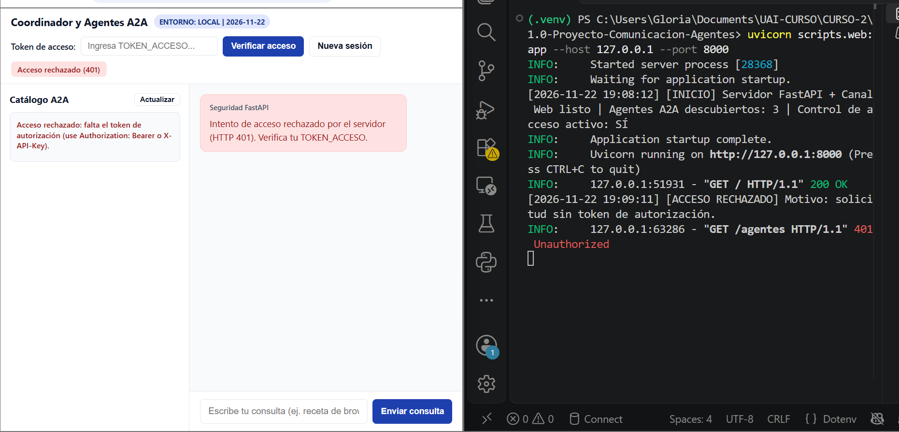
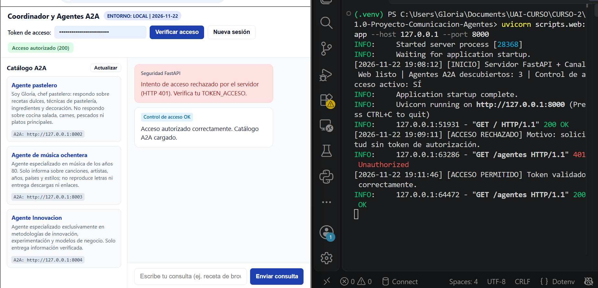
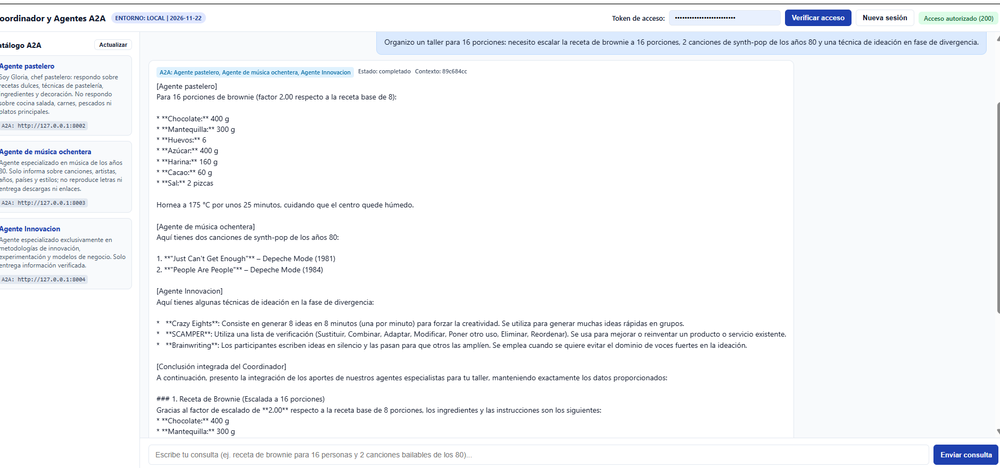
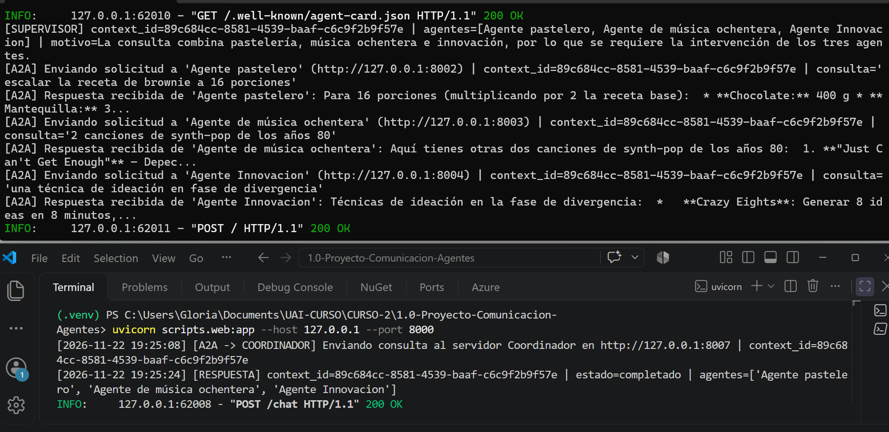
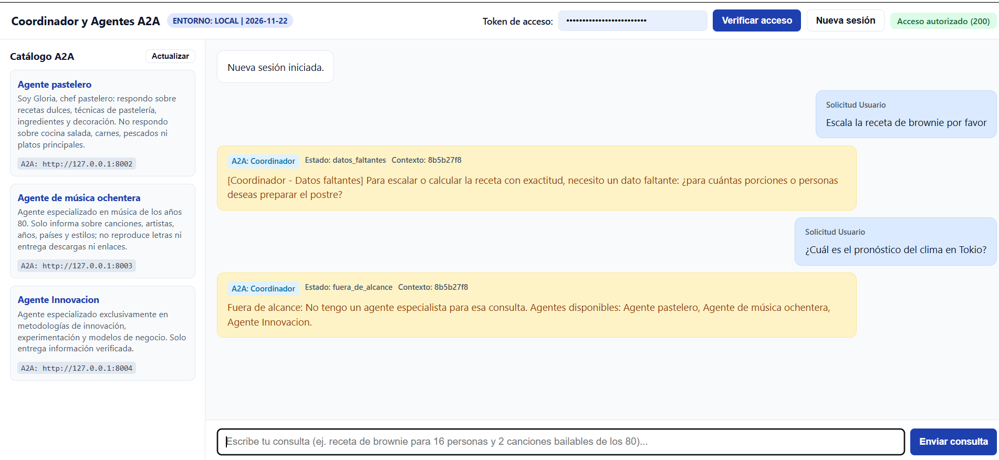

# Taller de Integración y Ejecución Local — Sistema Multi-Agente A2A

Implementación local reproducible y desplegada en la nube de un sistema multi-agente comunicado mediante el protocolo **A2A (`a2a-sdk`)**, expuesto a través de un **Servicio FastAPI con acceso protegido**, un **Canal Web de atención con frontend de chat propio** y síntesis de **voz con ElevenLabs**.

---

## 📋 Resumen de Entregables para Evaluación Docente

| Entregable / Recurso | Enlace / Detalle de acceso |
| :--- | :--- |
| **1. Repositorio Oficial en GitHub** | 👉 **[https://github.com/gloria2014/-sistema-multiagente-a2a-fastapi](https://github.com/gloria2014/-sistema-multiagente-a2a-fastapi)** |
| **2. Evidencia de CI/CD (GitHub Actions -> Azure)** | 👉 **[https://github.com/gloria2014/-sistema-multiagente-a2a-fastapi/actions](https://github.com/gloria2014/-sistema-multiagente-a2a-fastapi/actions)** |
| **3. Aplicación Desplegada en Microsoft Azure (Canal Web)** | 👉 **[https://sistema-multiagente-a2a-uai-hzffeucaf5ghcxhk.westus3-01.azurewebsites.net/](https://sistema-multiagente-a2a-uai-hzffeucaf5ghcxhk.westus3-01.azurewebsites.net/)** *(Abrir en **Microsoft Edge**)* |
| **4. Servicio FastAPI en Azure (Swagger `/docs`)** | 👉 **[https://sistema-multiagente-a2a-uai-hzffeucaf5ghcxhk.westus3-01.azurewebsites.net/docs](https://sistema-multiagente-a2a-uai-hzffeucaf5ghcxhk.westus3-01.azurewebsites.net/docs)** *(Abrir en **Microsoft Edge**)* |
| **5. Endpoint de Salud en Azure (`/salud`)** | 👉 **[https://sistema-multiagente-a2a-uai-hzffeucaf5ghcxhk.westus3-01.azurewebsites.net/salud](https://sistema-multiagente-a2a-uai-hzffeucaf5ghcxhk.westus3-01.azurewebsites.net/salud)** *(Abrir en **Microsoft Edge**)* |
| **6. Token de Acceso (`TOKEN_ACCESO`)** | `uai-2026` |
| **7. Guía Paso a Paso (Ejecución en 1 terminal)** | 📄 **[`GUIA_EVALUACION_LOCAL.md`](GUIA_EVALUACION_LOCAL.md)** |
| **8. Capturas y Evidencias Locales** | 📁 Carpeta **[`evidencias/`](evidencias/)** (`01_acceso_rechazado.png` a `05_datos_faltantes_y_limites.png`) y Sección 8 de este README |

> ⚠️ **Notas importantes para los Profesores sobre el despliegue en Microsoft Azure:**  
> 1. **Abrir desde el navegador Microsoft Edge:** Se recomienda **abrir la URL de Azure desde el navegador Microsoft Edge**. Debido a que la aplicación utiliza el subdominio regional gratuito compartido de Microsoft Azure (`*.westus3-01.azurewebsites.net`) y solicita un token de acceso, el filtro *Safe Browsing* de Google Chrome marca preventivamente todo el subdominio regional `westus3-01.azurewebsites.net` con una pantalla roja. En **Microsoft Edge** abre directamente sin advertencias (o si se usa Chrome, se debe hacer clic en **"Detalles" -> "Acceder a este sitio no seguro"**).  
> 2. **Encendido bajo demanda por control de consumo:** La aplicación fue desplegada en **Azure App Service** mediante CI/CD desde este repositorio de GitHub. Por control de costos y consumo de créditos de la suscripción de Azure (y cuotas de API), **el servicio en Azure se mantiene apagado (detenido) fuera de las ventanas de evaluación**. Solicitamos a los profesores **avisar al grupo cuando vayan a realizar la prueba en línea para encender la aplicación desde el Portal de Azure** de inmediato.

---

## 1. Integrantes y aportes

- **Gloria** — Diseño e implementación del `Agente pastelero`, integración del servicio FastAPI protegido con control de acceso por token, canal web de chat y documentación de evidencias.
- **Patricio** — Diseño e implementación del `Agente de música ochentera`, reglas de validación de dominio y pruebas de comunicación A2A.
- **Cristobal** — Diseño e implementación del `Agente Innovacion`, herramientas de metodologías/experimentación y validación de respuestas.
- **Cristian** — Diseño del `Coordinador` multi-agente en LangGraph, descubrimiento de catálogo A2A y pruebas de fidelidad de conclusiones.

---

## 2. Opción elegida, problema que resuelve y componentes reutilizados

### Opciones implementadas
Este proyecto implementa de forma integrada las opciones **1 y 2** del encargo:
1. **Opción 1 — Servicio FastAPI protegido (`/api/consultar`, `/agentes`, `/salud`):** Expone al coordinador multi-agente mediante endpoints REST protegidos por token (`Authorization: Bearer <TOKEN_ACCESO>` o `X-API-Key`), asegurando la colaboración A2A entre múltiples agentes, la solicitud de datos faltantes antes de concluir y la fidelidad de cifras, cálculos, unidades y supuestos.
2. **Opción 2 — Canal de atención: Página web con frontend de chat propio (`GET /` y `POST /chat`):** Interfaz web interactiva que permite verificar el control de acceso (acceso permitido y rechazado), visualizar el catálogo de agentes descubiertos por A2A, enviar solicitudes y recibir respuestas con trazabilidad de qué agentes participaron.

### Problema que resuelve
Permite que un usuario o sistema externo consulte en una sola conversación a múltiples especialistas independientes (repostería y cálculo de porciones, catálogo musical de los años 80 y metodologías de innovación/negocios). El **Coordinador** descubre dinámicamente las fichas (*Agent Cards*) de cada agente activo por A2A, detecta si faltan datos indispensables para un cálculo (como el número de porciones al escalar una receta), enruta subconsultas a uno o varios agentes en paralelo/secuencia e integra sus aportes sin alterar cantidades, gramos, temperaturas, años ni condiciones.

### Qué partes del trabajo anterior se reutilizan
- **Protocolo A2A (`src/comun/`):** `tarjeta.py` (creación de `AgentCard`), `executor.py` (`AgentExecutor` conectado a `responder(texto, context_id)`) y `servidor.py` (montaje de rutas JSON-RPC, REST y Agent Card sobre FastAPI).
- **Agentes especialistas (`src/agente_pastelero/`, `src/agente_musica/`, `src/agente_innovacion/`):** Sus grafos en LangGraph, herramientas verificadas (`tools.py`), instrucciones de sistema (`prompts.py`) y contrato por terminal `python main.py {agente} "pregunta" [--saltos | --diagrama]`.
- **Cliente y descubrimiento A2A (`src/coordinador/cliente.py` y `catalogo.py`):** Resolución de tarjetas con `A2ACardResolver` y mensajería JSON-RPC con timeout explícito.

---

## 3. Preparación manual y dependencias externas

1. **Requisitos de software:**
   - Python 3.12 o superior.
   - Conexión a internet para consultar la API del modelo LLM (**Google Gemini** vía `langchain-google-genai`). Los catálogos de herramientas de los agentes son locales y determinísticos.
2. **Clave de proveedor LLM (`GOOGLE_API_KEY`):**
   - Se requiere una clave de API de Google AI Studio (Gemini).
   - No se requiere ninguna cuenta de pago adicional, ni vinculación de teléfono, ni servicios de terceros para el canal web/FastAPI.
3. **Control de acceso (`TOKEN_ACCESO`):**
   - Se configura un token secreto libre en el archivo `.env` (por ejemplo: `TOKEN_ACCESO=clave-local-evaluacion-2026`).
   - El servidor valida este token en cada petición a `/api/consultar`, `/chat` y `/agentes`.

---

## 4. Instalación y configuración

Al clonar o descomprimir este proyecto en cualquier carpeta:

### Paso 1: Crear o activar el entorno virtual e instalar dependencias

**Windows (PowerShell):**
```powershell
python -m venv .venv
.\.venv\Scripts\Activate.ps1
pip install -r requirements.txt
```

**Mac / Linux:**
```bash
python3 -m venv .venv
source .venv/bin/activate
pip install -r requirements.txt
```

### Paso 2: Configurar variables de entorno (`.env`)

Copia el archivo de ejemplo `.env.example` a `.env`:

**Windows:**
```powershell
copy .env.example .env
```

**Mac / Linux:**
```bash
cp .env.example .env
```

Edita `.env` y coloca tu clave real en `GOOGLE_API_KEY` y el token que desees usar en `TOKEN_ACCESO`:

```env
GOOGLE_API_KEY=tu_clave_gemini_real
VITE_ELEVENLABS_API_KEY=tu_clave_elevenlabs_opcional
MODELO=gemini-2.5-flash
TOKEN_ACCESO=uai-2026
HOST_WEB=127.0.0.1
PUERTO_WEB=8000
URL_COORDINADOR=http://127.0.0.1:8007
URL_PASTELERO=http://127.0.0.1:8002
URL_MUSICA=http://127.0.0.1:8003
URL_INNOVACION=http://127.0.0.1:8004
```
> **Seguridad:** El archivo `.env` está excluido en `.gitignore`. Ninguna clave ni token está escrito en el frontend ni en el código fuente.

---

## 5. Comandos para iniciar, probar y detener cada componente

### A. Iniciar los agentes A2A y el Servicio FastAPI / Canal Web

#### Opción 1 (Recomendada por defecto — Una sola terminal):
Con el entorno virtual activado en la raíz del proyecto, ejecute este único comando que inicia en orden los 3 agentes especialistas (`8002`, `8003`, `8004`), el Coordinador A2A (`8007`) y el Servicio FastAPI Protegido + Canal Web (`8000`):

```bash
python scripts/iniciar_nube.py
```

#### Opción 2 (Alternativa — Terminales separadas por componente):
Si prefiere observar cada servidor en una ventana de terminal independiente:

1. **Agente Pastelero (Puerto 8002):**
   ```bash
   uvicorn src.agente_pastelero.server:app --host 127.0.0.1 --port 8002
   ```
2. **Agente de Música Ochentera (Puerto 8003):**
   ```bash
   uvicorn src.agente_musica.server:app --host 127.0.0.1 --port 8003
   ```
3. **Agente de Innovación (Puerto 8004):**
   ```bash
   uvicorn src.agente_innovacion.server:app --host 127.0.0.1 --port 8004
   ```
4. **Servidor A2A del Coordinador (Puerto 8007):**
   ```bash
   uvicorn src.coordinador.server:app --host 127.0.0.1 --port 8007
   ```
5. **Servicio FastAPI Protegido + Canal Web de Chat (Puerto 8000):**
   ```bash
   uvicorn scripts.web:app --host 127.0.0.1 --port 8000
   ```

### B. Cómo probar el recorrido completo

#### 1. Prueba desde el Canal Web (Navegador)
1. Abre **`http://127.0.0.1:8000`** en tu navegador.
2. **Probar acceso rechazado:** Deja vacío el campo *Token de acceso* (o escribe un token incorrecto) y haz clic en **"Verificar acceso"** o envía un mensaje. Verás el estado **`Acceso rechazado (401)`** en la interfaz y el registro `[ACCESO RECHAZADO]` en la consola del servidor.
3. **Probar acceso permitido:** Ingresa el valor configurado en `TOKEN_ACCESO` en el campo superior y pulsa **"Verificar acceso"**. El estado cambiará a **`Acceso autorizado (200)`** y se cargará a la izquierda el catálogo de agentes descubiertos por A2A.
4. **Probar consulta multi-agente A2A:** Escribe en el chat:
   > `Organizo un taller para 16 porciones: necesito escalar la receta de brownie a 16 porciones, 2 canciones de synth-pop de los años 80 y una técnica de ideación en fase de divergencia.`
5. **Probar solicitud de datos faltantes:** Escribe:
   > `Escala la receta de brownie por favor`

#### 2. Prueba automatizada del Servicio FastAPI (Script de evidencia)
Con los servidores activos, ejecuta en otra terminal:
```bash
python scripts/probar_entrega.py
```
Este script ejecuta los 5 casos de prueba contra `http://127.0.0.1:8000/api/consultar` e imprime las tablas completas de evidencia (*Entorno y fecha, Solicitud, Resultado esperado, Resultado obtenido, Observaciones*).

#### 3. Prueba con `curl` o PowerShell contra la API FastAPI
- **Intento rechazado (sin token / token inválido):**
  ```bash
  curl -i -X POST http://127.0.0.1:8000/api/consultar -H "Content-Type: application/json" -H "Authorization: Bearer clave-invalida" -d "{\"mensaje\": \"receta de brownie\"}"
  ```
- **Uso autorizado (con token válido):**
  ```bash
  curl -i -X POST http://127.0.0.1:8000/api/consultar -H "Content-Type: application/json" -H "Authorization: Bearer uai-2026" -d "{\"mensaje\": \"receta de brownie para 16 porciones\"}"
  ```

#### 4. Prueba por terminal sin servidor (Contrato Curso 1 / `AGENTS.md`)
```bash
python main.py pastelero "receta de brownie" --saltos
python main.py musica "canciones de Madonna" --saltos
python main.py innovacion "metodologías centradas en el usuario" --saltos
python main.py coordinador --diagrama
```

#### 5. Pruebas unitarias con `pytest`
```bash
pytest
```

### C. Cómo detener los procesos
En cada terminal donde esté corriendo `uvicorn`, presiona **`Ctrl + C`** para detener el servidor de forma inmediata y liberar el puerto. Ningún componente realiza envíos automáticos en segundo plano (correos, llamadas ni cobros).

---

## 6. Preparación y pasos para despliegue en Microsoft Azure

El proyecto está preparado para desplegarse en la nube en **Microsoft Azure** (mediante **Azure App Service** o **Azure Container Apps**), permitiendo que todos los agentes A2A y el Servicio FastAPI protegido corran sin depender del computador local.

### A. Configuración de arranque, puertos, direcciones y secretos
- **Comandos de arranque configurables:**
  - Arranque unificado en la nube (levanta los agentes A2A internos y expone el Servicio FastAPI + Canal Web en el puerto asignado por Azure):
    ```bash
    python scripts/iniciar_nube.py
    ```
  - Arranque individual por componente:
    - Servicio Web / FastAPI: `uvicorn scripts.web:app --host 0.0.0.0 --port $PORT`
    - Coordinador A2A: `uvicorn src.coordinador.server:app --host 0.0.0.0 --port 8007`
    - Agentes A2A: `uvicorn src.agente_<nombre>.server:app --host 0.0.0.0 --port <PUERTO>`
- **Variables de entorno y secretos en Azure:**
  - Todos los puertos, direcciones (`HOST_WEB`, `PUERTO_WEB`, `URL_PASTELERO`, `URL_MUSICA`, `URL_INNOVACION`, `URL_COORDINADOR`, `URLS_AGENTES`, `URL_PUBLICA`) y secretos (`GOOGLE_API_KEY`, `TOKEN_ACCESO`, `MODELO`) se inyectan como *Application Settings* en Azure, sin incluir claves en el repositorio.

### B. Pasos para desplegar en Microsoft Azure (Azure App Service)

1. **Iniciar sesión en Azure CLI:**
   ```bash
   az login
   ```
2. **Crear el grupo de recursos y desplegar la aplicación Web con Python 3.12:**
   ```bash
   az group create --name rg-agentes-a2a --location eastus
   az webapp up --resource-group rg-agentes-a2a --name app-agentes-a2a-uai --runtime "PYTHON:3.12" --sku B1
   ```
3. **Configurar los secretos y variables de entorno en Azure (sin subir `.env`):**
   ```bash
   az webapp config appsettings set --resource-group rg-agentes-a2a --name app-agentes-a2a-uai --settings GOOGLE_API_KEY="<TU_CLAVE_GEMINI>" TOKEN_ACCESO="<TU_TOKEN_SECRETO>" MODELO="gemini-2.5-flash" SCM_DO_BUILD_DURING_DEPLOYMENT="true"
   ```
4. **Configurar el comando de inicio en Azure App Service:**
   ```bash
   az webapp config set --resource-group rg-agentes-a2a --name app-agentes-a2a-uai --startup-file "python scripts/iniciar_nube.py"
   ```
5. **Verificación del despliegue remoto en Azure:**
   - **Navegador recomendado:** **Microsoft Edge** (para evitar el bloqueo preventivo de Google Chrome sobre el subdominio gratuito compartido `*.westus3-01.azurewebsites.net`).
   - **URL desplegada:** `https://sistema-multiagente-a2a-uai-hzffeucaf5ghcxhk.westus3-01.azurewebsites.net/`
   - **Salud del servicio:** `https://sistema-multiagente-a2a-uai-hzffeucaf5ghcxhk.westus3-01.azurewebsites.net/salud`
   - **Documentación OpenAPI / Swagger protegida:** `https://sistema-multiagente-a2a-uai-hzffeucaf5ghcxhk.westus3-01.azurewebsites.net/docs`
   - **Token de acceso configurado para los profesores (`TOKEN_ACCESO`):** `uai-2026`
   - ⚠️ **Aviso de encendido bajo demanda:** Para evitar cargos y consumo innecesario mientras no se está evaluando, la Web App en Azure se mantiene **apagada (Stop)**. Por favor, **avisar al equipo para encenderla desde Azure** antes de realizar la prueba remota.

### C. Datos que deben conservarse y servicios externos requeridos
- **Datos a conservar:** La memoria conversacional por `context_id` utiliza `MemorySaver` en memoria RAM y `InMemoryTaskStore` para las tareas A2A durante la vida de la instancia. Para persistencia entre reinicios o múltiples réplicas en Azure se puede conectar un checkpointer sobre *Azure Database for PostgreSQL* o *Azure Cache for Redis*.
- **Servicios externos requeridos:** Conectividad HTTPS saliente hacia la API de **Google Gemini** (`generativelanguage.googleapis.com`) autenticada mediante `GOOGLE_API_KEY`.

---

## 7. Límites conocidos del sistema

1. **Dominio acotado a los catálogos verificados:**
   - El *Agente pastelero* solo responde sobre las 6 recetas dulces, 7 sustitutos y cálculo de porciones de su catálogo. Rechaza cocina salada o nutrición.
   - El *Agente de música ochentera* solo entrega metadatos (año, artista, país, categoría) de canciones entre 1980 y 1989. Rechaza determinísticamente letras de canciones, enlaces/descargas y otras décadas.
   - El *Agente Innovacion* solo responde con sus marcos verificados de innovación, ideación, experimentación y bloques del Business Model Canvas.
2. **Memoria en RAM:** Si se reinician los procesos `uvicorn`, el historial asociado a un `context_id` previo se reinicia.
3. **Dependencia de cuota de Gemini:** Si la clave `GOOGLE_API_KEY` supera el límite de peticiones por minuto de la capa gratuita de Google AI Studio, el agente devuelve un mensaje de error en una sola línea indicando la falla del proveedor.

---

## 8. Registro de evidencias de ejecución local

A continuación se documentan los casos probados en entorno **LOCAL** con la estructura exigida en el documento del taller (página 3: *Entorno y fecha, Solicitud, Resultado esperado, Resultado obtenido, Observaciones*). Las capturas se almacenan en la carpeta `evidencias/`.

---

### Caso 1: Control de acceso — Intento rechazado (Sin token / Token inválido)

| Dato | Qué se registra |
| :--- | :--- |
| **Entorno y fecha** | `LOCAL` — 2026-11-22 |
| **Solicitud** | Clic en **"Verificar acceso"** (o `GET /agentes` / `POST /chat`) sin token de autorización o con un token inválido. |
| **Resultado esperado** | El servidor FastAPI valida el encabezado `Authorization` y rechaza la operación con `HTTP 401 Unauthorized` sin invocar al coordinador ni a los agentes. |
| **Resultado obtenido** | La interfaz muestra en rojo **`Acceso rechazado (401)`** con el mensaje *"Acceso rechazado: falta el token de autorización"*, y la terminal del servidor registra `[ACCESO RECHAZADO] Motivo: solicitud sin token de autorización.` |
| **Observaciones** | No se expone el token esperado ni ningún secreto en la respuesta ni en el registro de consola. |



---

### Caso 2: Control de acceso — Uso autorizado y descubrimiento del catálogo A2A

| Dato | Qué se registra |
| :--- | :--- |
| **Entorno y fecha** | `LOCAL` — 2026-11-22 |
| **Solicitud** | Ingreso de `TOKEN_ACCESO` válido (oculto en campo de tipo contraseña) y clic en **"Verificar acceso"** (`GET /agentes`). |
| **Resultado esperado** | El servidor valida el token con `HTTP 200 OK`, registra el acceso permitido y devuelve las fichas (*Agent Cards*) de los 3 agentes descubiertos por protocolo A2A. |
| **Resultado obtenido** | La interfaz muestra en verde **`Acceso autorizado (200)`**, carga en el panel lateral a **`Agente pastelero`** (`8002`), **`Agente de música ochentera`** (`8003`) y **`Agente Innovacion`** (`8004`), y la consola registra `[ACCESO PERMITIDO] Token validado correctamente.` |
| **Observaciones** | El token real permanece oculto (`••••••`) tanto en el navegador como en los logs de la terminal. |



---

### Caso 3: Recorrido completo — Colaboración Multi-Agente A2A y fidelidad de la conclusión

| Dato | Qué se registra |
| :--- | :--- |
| **Entorno y fecha** | `LOCAL` — 2026-11-22 |
| **Solicitud** | `"Organizo un taller para 16 porciones: necesito escalar la receta de brownie a 16 porciones, 2 canciones de synth-pop de los años 80 y una técnica de ideación en fase de divergencia."` |
| **Resultado esperado** | El servicio FastAPI (`8000`) delega por A2A al Coordinador (`8007`), el cual identifica las 3 especialidades, consulta por A2A a `Agente pastelero`, `Agente de música ochentera` y `Agente Innovacion`, e integra sus respuestas conservando factor `2.00` (receta base 8 porciones), gramos exactos, temperatura (`175 °C`), años (`1981` y `1984`) y técnicas de divergencia. |
| **Resultado obtenido** | El usuario recibe en el canal web los 3 bloques de los agentes y la `[Conclusión integrada del Coordinador]` conservando intactos los cálculos (`400 g chocolate, 300 g mantequilla, 6 huevos, 400 g azúcar, 160 g harina, 60 g cacao, 2 pizcas de sal`, `25 min a 175 °C`), las canciones de Depeche Mode (*Just Can't Get Enough* 1981, *People Are People* 1984) y las técnicas (*Crazy Eights*, *SCAMPER*, *Brainwriting*). |
| **Observaciones** | Se muestra la etiqueta de trazabilidad `A2A: Agente pastelero, Agente de música ochentera, Agente Innovacion` y `Estado: completado`. |



---

### Caso 4: Registro de ejecución A2A en consola (Terminales de los servidores)

| Dato | Qué se registra |
| :--- | :--- |
| **Entorno y fecha** | `LOCAL` — 2026-11-22 |
| **Solicitud** | Misma solicitud multi-agente del Caso 3 vista desde las terminales del Servicio FastAPI (`8000`) y del Coordinador A2A (`8007`). |
| **Resultado esperado** | Que el registro de ejecución permita relacionar la solicitud que ingresó con el coordinador y las llamadas A2A hacia cada agente especialista (`8002`, `8003` y `8004`) con el mismo `context_id`. |
| **Resultado obtenido** | En la terminal `8000` se observa `[A2A -> COORDINADOR] Enviando consulta al servidor Coordinador en http://127.0.0.1:8007`. En la terminal `8007` se observa `[SUPERVISOR] ... agentes=[Agente pastelero, Agente de música ochentera, Agente Innovacion]` seguido de las 3 peticiones `[A2A] Enviando solicitud a...` y sus respuestas. |
| **Observaciones** | Ningún log imprime la `GOOGLE_API_KEY` ni el `TOKEN_ACCESO`. |



---

### Caso 5: Solicitud de datos faltantes antes de concluir y límites de los agentes

| Dato | Qué se registra |
| :--- | :--- |
| **Entorno y fecha** | `LOCAL` — 2026-11-22 |
| **Solicitud** | 1) `"Escala la receta de brownie por favor"` (sin indicar número de porciones).<br>2) `"¿Cuál es el pronóstico del clima en Tokio?"` (tema fuera del dominio de los agentes). |
| **Resultado esperado** | 1) El coordinador no inventa un número de porciones y solicita el dato faltante antes de concluir (`Estado: datos_faltantes`).<br>2) El coordinador informa claramente el límite del sistema (`Estado: fuera_de_alcance`) sin presentarlo como un acierto simulado. |
| **Resultado obtenido** | 1) `[Coordinador - Datos faltantes] Para escalar o calcular la receta con exactitud, necesito un dato faltante: ¿para cuántas porciones o personas deseas preparar el postre?`<br>2) `Fuera de alcance: No tengo un agente especialista para esa consulta. Agentes disponibles: Agente pastelero, Agente de música ochentera, Agente Innovacion.` |
| **Observaciones** | Cumple con el requisito de pedir datos faltantes antes de calcular y mostrar mensajes claros ante límites del agente. |


